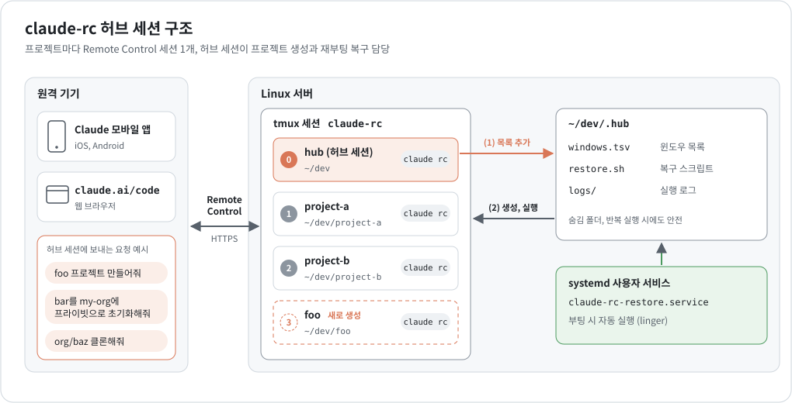
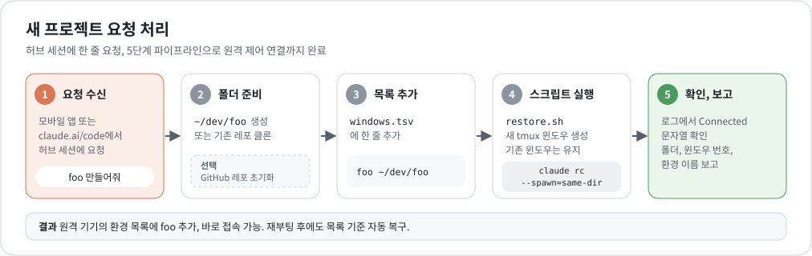
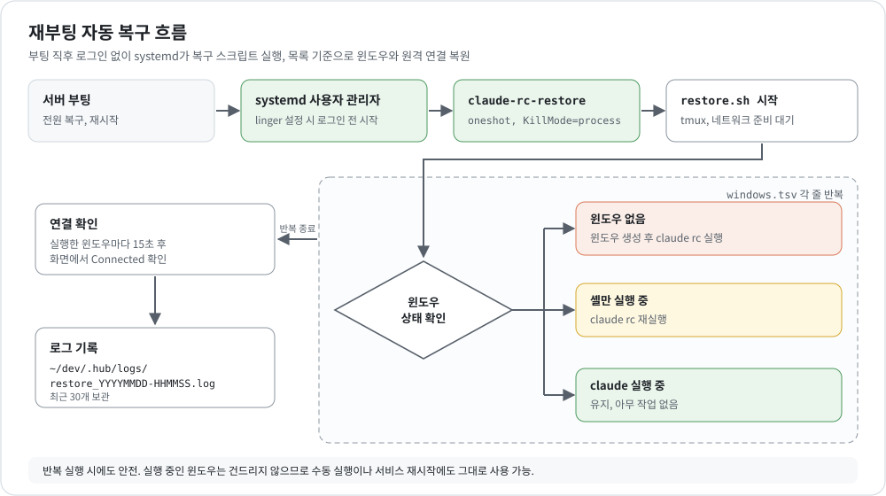

# claude-rc-hub-session

서버 한 대의 `~/dev` 아래 프로젝트마다 Claude Code Remote Control 세션을 하나씩 띄우고, 이 세션들을 **허브 세션** 하나가 생성하고 관리하는 구성입니다. 휴대폰이나 `claude.ai/code`에서 "foo 프로젝트 만들어줘" 한 줄을 보내면 폴더 준비, GitHub 레포 초기화, tmux 윈도우 생성, 원격 연결까지 끝납니다. 서버가 재부팅되면 systemd 사용자 서비스가 같은 구성을 자동으로 복구합니다.



## 목차

1. [개요](#1-개요)
2. [구성 요소](#2-구성-요소)
3. [사전 준비](#3-사전-준비)
4. [설치 절차](#4-설치-절차)
5. [사용 방법](#5-사용-방법)
6. [재부팅 자동 복구](#6-재부팅-자동-복구)
7. [프롬프트 원문](#7-프롬프트-원문)
8. [문제 해결](#8-문제-해결)
9. [파일 구조](#9-파일-구조)

## 1. 개요

| 용어 | 설명 |
|---|---|
| Remote Control | 로컬 머신의 Claude Code 세션을 Claude 모바일 앱이나 `claude.ai/code`에서 조작하는 기능. `claude remote-control`, 줄여서 `claude rc`로 실행. |
| 프로젝트 세션 | 프로젝트 폴더마다 tmux 윈도우 1개, 그 안에서 실행 중인 `claude rc` 1개. 원격 기기에서는 프로젝트별 환경으로 표시. |
| 허브 세션 | `~/dev`에서 실행되는 프로젝트 세션. `~/dev/CLAUDE.md` 지침에 따라 새 프로젝트 요청을 처리. |
| 복구 체계 | 윈도우 목록 파일, 복구 스크립트, systemd 사용자 서비스로 구성된 재부팅 자동 복구 장치. |

이 구성이 적합한 경우는 다음과 같습니다.

- 서버 한 대를 여러 프로젝트의 작업 공간으로 사용하는 경우
- 터미널 접속 없이 휴대폰에서 새 프로젝트를 시작하고 싶은 경우
- 서버 재부팅 후 프로젝트 세션을 하나씩 다시 띄우는 작업을 없애고 싶은 경우

## 2. 구성 요소

| 구성 요소 | 위치 | 역할 |
|---|---|---|
| tmux 세션 | `claude-rc` | 프로젝트별 윈도우 보관. 0번 윈도우가 허브 세션. |
| 허브 지침 | `~/dev/CLAUDE.md` | 허브 세션 역할과 새 프로젝트 처리 절차. Claude Code가 세션 시작 시 자동으로 읽음. |
| 윈도우 목록 | `~/dev/.hub/windows.tsv` | `윈도우명<TAB>폴더 절대경로` 형식. 복구 순서 기준. |
| 복구 스크립트 | `~/dev/.hub/restore.sh` | 목록 기준 윈도우 생성과 `claude rc` 실행. 반복 실행 시에도 안전. |
| 실행 로그 | `~/dev/.hub/logs/` | 복구 스크립트 실행 기록. 최근 30개 보관. |
| systemd 서비스 | `~/.config/systemd/user/claude-rc-restore.service` | 부팅 시 복구 스크립트 실행. |

복구 관련 파일은 모두 숨김 폴더 `~/dev/.hub`에 모아 프로젝트 폴더 목록을 깨끗하게 유지합니다.

## 3. 사전 준비

| 항목 | 확인 명령 |
|---|---|
| systemd 기반 Linux 서버 | `systemctl --user status` |
| tmux | `tmux -V` |
| Claude Code CLI와 구독 Claude 계정 로그인 | `claude --version`, `claude rc --help` |
| GitHub CLI 로그인 (레포 생성과 클론에 사용) | `gh auth status` |
| 프로젝트 상위 폴더 | `mkdir -p ~/dev` |

Remote Control은 구독이 있는 Claude 계정으로 로그인한 상태에서만 동작합니다. `claude rc --help`의 요구 사항 항목에서 확인할 수 있습니다.

## 4. 설치 절차

두 가지 방법 중 하나를 선택합니다. 프롬프트 방식은 Claude가 환경 확인, 파일 배치, 검증까지 수행합니다.

### 4.1 프롬프트 방식 (권장)

1. 서버에서 일반 Claude Code 세션을 시작합니다.
   ```bash
   cd ~/dev && claude
   ```
2. [`prompts/setup-prompt.md`](prompts/setup-prompt.md) 내용을 붙여넣습니다. 설정값의 `<GITHUB_ID>`, `<EMAIL>`, `<ORG>`는 미리 바꿔 둡니다.
3. Claude가 환경 확인, 파일 배치, 4단계 검증, 서비스 등록을 수행하고 결과를 보고합니다.
4. 보고에 linger 설정 안내가 있으면 직접 실행합니다.
   ```bash
   sudo loginctl enable-linger "$USER"
   ```
5. 설정용 세션을 종료합니다. 이후에는 tmux `claude-rc` 세션의 hub 윈도우가 허브 세션 역할을 맡습니다.

### 4.2 수동 방식

1. **파일 배치**
   ```bash
   git clone https://github.com/hungryZoo/claude-rc-hub-session.git /tmp/claude-rc-hub-session
   mkdir -p ~/dev/.hub ~/.config/systemd/user
   cp /tmp/claude-rc-hub-session/hub/restore.sh ~/dev/.hub/
   cp /tmp/claude-rc-hub-session/templates/CLAUDE.md ~/dev/CLAUDE.md
   cp /tmp/claude-rc-hub-session/systemd/claude-rc-restore.service ~/.config/systemd/user/
   printf 'hub\t%s/dev\n' "$HOME" > ~/dev/.hub/windows.tsv
   ```
2. **설정값 입력**: `~/dev/CLAUDE.md`의 `<GITHUB_ID>`, `<EMAIL>`, `<ORG>`를 바꿉니다.
3. **계획 확인과 첫 실행**
   ```bash
   HUB_DRY_RUN=1 ~/dev/.hub/restore.sh   # 실행 없이 계획만 출력
   ~/dev/.hub/restore.sh                 # claude-rc 세션과 hub 윈도우 시작
   ```
4. **폴더 신뢰 승인**: 처음 실행하는 폴더는 신뢰 확인 프롬프트가 뜹니다. 로그에 "대기"가 보이면 윈도우에 들어가 `y`를 입력하고 `Ctrl-b d`로 빠져나옵니다.
   ```bash
   tmux attach -t claude-rc
   ```
5. **부팅 시 자동 실행 등록**
   ```bash
   systemctl --user daemon-reload
   systemctl --user enable --now claude-rc-restore.service
   loginctl show-user "$USER" -p Linger   # Linger=no면 아래 명령 실행
   sudo loginctl enable-linger "$USER"
   ```

`~/dev` 대신 다른 상위 폴더를 쓰면 서비스 파일의 `ExecStart` 경로와 `windows.tsv`의 hub 경로를 함께 바꿉니다.

## 5. 사용 방법

Claude 모바일 앱이나 `claude.ai/code`의 환경 목록에서 hub 환경(`~/dev`)을 선택하고 요청을 보냅니다.



| 요청 예시 | 허브 세션 동작 |
|---|---|
| foo 프로젝트 만들어줘 | `~/dev/foo` 생성, 목록 추가, 윈도우 생성과 `claude rc` 실행 |
| bar 프로젝트를 my-org에 프라이빗으로 초기화해줘 | 위 동작과 함께 `git init`, 초기 커밋, `gh repo create my-org/bar --private` |
| https://github.com/org/baz 클론해서 원격제어 만들어줘 | `gh repo clone org/baz`, 목록 추가, 윈도우 생성과 `claude rc` 실행 |
| foo 프로젝트 원격제어 내려줘 | 목록에서 줄 삭제, 윈도우 종료. 폴더 삭제는 확인 후에만 수행. |

허브 세션이 연결 확인을 마치면 원격 기기의 환경 목록에 새 프로젝트가 나타납니다. 그 환경을 선택하면 해당 프로젝트 폴더에서 바로 작업할 수 있습니다.

서버에서 직접 확인할 때는 다음 명령을 씁니다.

```bash
tmux list-windows -t claude-rc -F '#{window_index}: #{window_name} [#{pane_current_path}]'
tmux attach -t claude-rc                       # 윈도우 화면 확인, Ctrl-b d로 빠져나오기
tail -n 30 "$(ls -1t ~/dev/.hub/logs/restore_*.log | head -1)"
```

## 6. 재부팅 자동 복구



부팅 직후 systemd 사용자 관리자가 `claude-rc-restore.service`를 실행하고, 서비스는 `restore.sh`를 호출합니다. linger가 켜져 있으면 로그인하지 않아도 이 과정이 진행됩니다. 스크립트는 tmux와 네트워크가 준비될 때까지 기다린 뒤 `windows.tsv`를 위에서부터 한 줄씩 처리합니다.

| 윈도우 상태 | 동작 |
|---|---|
| 윈도우 없음 | 윈도우 생성 후 `claude rc --spawn=same-dir` 실행 |
| 셸만 실행 중 | `claude rc --spawn=same-dir` 재실행 |
| claude 실행 중 | 유지 |
| 다른 프로그램 실행 중 | 건너뜀 |
| 목록의 폴더 없음 | 건너뜀 |

실행한 윈도우는 15초 뒤 화면에서 `Connected` 문자열을 찾아 연결 여부를 로그에 남깁니다. 재부팅 후에는 원격 연결이 새로 만들어지므로 환경 이름이 바뀔 수 있습니다. 이전 대화 기록 파일은 `~/.claude` 아래에 그대로 남아 있습니다.

**수동 실행과 상태 확인**

```bash
~/dev/.hub/restore.sh                                  # 수동 복구
HUB_DRY_RUN=1 ~/dev/.hub/restore.sh                    # 계획만 출력
systemctl --user status claude-rc-restore.service      # 서비스 상태
journalctl --user -u claude-rc-restore.service -b      # 이번 부팅의 서비스 출력
```

**복구 스크립트 환경변수**

| 변수 | 기본값 | 용도 |
|---|---|---|
| `HUB_DRY_RUN` | `0` | `1`이면 실행 없이 계획만 출력 |
| `HUB_SESSION` | `claude-rc` | tmux 세션 이름 |
| `HUB_MANIFEST` | 스크립트 옆 `windows.tsv` | 목록 파일 경로 |
| `HUB_TMUX_BIN` | 자동 감지 | tmux 실행 파일 경로 |
| `HUB_TMUX_SOCKET` | 기본 소켓 | `tmux -L` 소켓 이름. 실제 세션과 분리된 테스트에 사용. |
| `HUB_CMD` | `claude rc --spawn=same-dir` | 윈도우에서 실행할 명령 |

**재부팅 없이 복구 시험하기**

실제 원격 세션을 만들지 않도록 별도 tmux 소켓과 대체 명령을 사용합니다.

```bash
systemd-run --user --wait -p KillMode=process \
  -E HUB_TMUX_SOCKET=hubtest -E 'HUB_CMD=claude --version; sleep 300' \
  ~/dev/.hub/restore.sh
tmux -L hubtest list-windows -t claude-rc      # 목록대로 윈도우 생성 확인
tmux -L hubtest kill-server                    # 시험 종료
```

**`KillMode=process`가 필요한 이유**

systemd는 기본적으로 서비스의 메인 프로세스가 끝나면 같은 cgroup에 남은 프로세스를 모두 종료합니다. 부팅 시 tmux 서버는 복구 스크립트의 자식으로 시작되므로 이 설정이 없으면 스크립트 종료 직후 tmux 서버와 모든 `claude rc`가 함께 종료됩니다. `KillMode=process`를 넣으면 서비스를 중지하거나 재시작해도 tmux 서버가 유지됩니다.

## 7. 프롬프트 원문

<details>
<summary><b>초기 설정 프롬프트</b> (<code>prompts/setup-prompt.md</code>, 새 머신에서 한 번 사용)</summary>

```markdown
너는 이 머신에 "claude-rc 허브 세션" 환경을 구성한다.
참고 레포: https://github.com/hungryZoo/claude-rc-hub-session

## 설정값
- 프로젝트 상위 폴더: ~/dev
- GitHub 사용자: <GITHUB_ID>
- 커밋 이메일: <EMAIL>
- 기본 GitHub 조직: <ORG> (없으면 개인 계정)

## 1. 환경 확인
- tmux 실행 경로와 버전. snap 설치이고 `tmux -V`가 출력 없이 끝나면 /snap/tmux/current/usr/local/bin/tmux 직접 호출.
- claude CLI 버전과 `claude rc --help` 동작, gh 로그인 상태, git 버전과 전역 사용자 정보
- `systemctl --user` 동작 여부, `loginctl show-user $USER -p Linger` 값
- Bash 샌드박스가 tmux 소켓 접근을 막으면 tmux 명령만 샌드박스 해제로 실행.

## 2. 파일 배치
- 참고 레포를 임시 폴더에 클론.
- hub/restore.sh → ~/dev/.hub/restore.sh (실행 권한 부여)
- ~/dev/.hub/windows.tsv 생성. 첫 줄은 `hub<TAB>$HOME/dev`. tmux `claude-rc` 세션이 이미 있으면 기존 윈도우 이름과 경로를 목록에 반영.
- templates/CLAUDE.md → ~/dev/CLAUDE.md, 설정값 채움. 기존 파일이 있으면 덮어쓰지 말고 병합안 제시.
- systemd/claude-rc-restore.service → ~/.config/systemd/user/. 상위 폴더가 ~/dev가 아니면 ExecStart 경로 수정.

## 3. 검증 (4단계)
(1) `HUB_DRY_RUN=1 ~/dev/.hub/restore.sh` 로 계획 확인
(2) 테스트 소켓으로 재부팅 상황 재현:
    `systemd-run --user --wait -p KillMode=process -E HUB_TMUX_SOCKET=hubtest -E 'HUB_CMD=claude --version; sleep 300' ~/dev/.hub/restore.sh`
    → 모든 윈도우 생성과 각 윈도우의 claude 버전 출력 확인
(3) 같은 테스트 세션에 한 번 더 실행해 "건너뜀" 또는 "유지" 판단 확인 후 `tmux -L hubtest kill-server`
(4) KillMode=process 없이 실행하면 테스트 tmux가 사라지는 점을 이해하고, 실제 서비스 파일에 해당 설정이 있는지 확인

## 4. 시작과 등록
- `~/dev/.hub/restore.sh` 실행으로 `claude-rc` 세션과 hub 윈도우 시작
- 폴더 신뢰 프롬프트가 뜨면 y 전송 후 "Connected" 확인
- `systemctl --user daemon-reload && systemctl --user enable --now claude-rc-restore.service`
- Linger=no면 `sudo loginctl enable-linger $USER` 실행 필요 사실을 나에게 알림

## 5. 보고
- 배치한 파일 목록, 검증 결과, 허브 윈도우 연결 여부와 환경 이름
- 이 머신의 특이사항은 메모리에 기록
```

</details>

<details>
<summary><b>허브 지침</b> (<code>templates/CLAUDE.md</code>, <code>~/dev/CLAUDE.md</code>로 배치)</summary>

```markdown
# 허브 세션 지침

이 폴더(`~/dev`)에서 실행되는 Claude Code 세션은 "허브 세션"이다. `~/dev`는 프로젝트 폴더만 모아두는 상위 폴더이고, 새 프로젝트 요청은 허브 세션이 처리한다. 프로젝트마다 tmux `claude-rc` 세션의 윈도우 1개와 그 안의 `claude rc` 프로세스 1개를 둔다.

## 설정값

- GitHub 사용자: `<GITHUB_ID>`
- 커밋 이메일: `<EMAIL>` (공개 레포는 `<ID>+<GITHUB_ID>@users.noreply.github.com` 권장)
- 기본 GitHub 조직: `<ORG>` (없으면 개인 계정)

## 새 프로젝트 요청 처리 (5단계 파이프라인)

1. **폴더 준비**
   - 새 프로젝트: `~/dev/<이름>/` 생성
   - 기존 레포: `gh repo clone <owner>/<repo>` 로 `~/dev/<repo>/` 클론
2. **GitHub 초기화** (요청한 경우만)
   - `git init` 후 `git checkout -b main` (git 2.28 미만은 `git init -b` 미지원)
   - 전역 git 사용자 정보가 없으면 레포 로컬로만 `git config user.name`, `git config user.email` 설정
   - `.gitignore`(`logs/`, `.venv/`, `__pycache__/`, `.env`)와 `README.md` 초기 커밋
   - `gh repo create <owner>/<이름> --private --source=. --remote=origin --push` (공개 요청 시 `--public`)
3. **목록 추가**: `~/dev/.hub/windows.tsv`에 `윈도우명<TAB>절대경로` 한 줄 추가. 구분자는 탭 문자.
4. **복구 스크립트 실행**: `~/dev/.hub/restore.sh`
   - 목록에 있고 tmux에 없는 윈도우만 생성 후 `claude rc --spawn=same-dir` 실행
   - 이미 실행 중인 윈도우는 유지
5. **확인과 보고**
   - 최신 로그 `~/dev/.hub/logs/restore_*.log`에서 "연결 확인" 확인
   - "대기" 표시(폴더 신뢰 프롬프트)면 레포의 `.claude/`, `.mcp.json` 존재 여부 확인 후 `tmux send-keys -t 'claude-rc:=<윈도우명>' y Enter`
   - 보고 항목: 폴더 경로, 윈도우 번호와 이름, 연결 여부, 환경 이름

## 운영 규칙

- 윈도우 실행 명령은 항상 `claude rc --spawn=same-dir`로 통일.
- 실행 중인 윈도우는 재시작 금지. 이름 변경 같은 비파괴 작업만 허용.
- 프로젝트 제거 요청: `windows.tsv`에서 해당 줄 삭제, `tmux kill-window -t 'claude-rc:=<윈도우명>'`. 폴더 삭제는 사용자 확인 후에만 수행.
- tmux가 snap 설치이고 `tmux -V`가 출력 없이 끝나면 `/snap/tmux/current/usr/local/bin/tmux`를 직접 호출.
- Bash 샌드박스가 tmux 소켓(`/tmp/tmux-<UID>/`) 접근을 막으면 tmux 명령만 샌드박스 해제로 실행.
- 이 머신에서 발견한 특이사항(tmux 경로, git 버전 등)은 메모리에 기록.
```

</details>

허브 지침을 `~/dev/CLAUDE.md`에 두면 `~/dev`에서 시작하는 모든 Claude Code 세션이 이 지침을 자동으로 읽습니다. 그래서 재부팅 후 새로 연결된 허브 세션도 같은 역할을 이어받습니다.

## 8. 문제 해결

| 증상 | 원인과 조치 |
|---|---|
| `tmux` 명령이 출력 없이 종료 | snap 설치 tmux의 `/snap/bin/tmux` 래퍼가 일부 환경에서 동작하지 않음. `/snap/tmux/current/usr/local/bin/tmux`를 직접 호출. 복구 스크립트는 자동 감지. |
| 스크립트 종료 직후 tmux 세션이 사라짐 | 서비스 파일에 `KillMode=process` 누락. `systemd-run`으로 시험할 때도 `-p KillMode=process` 필요. |
| 로그인하기 전까지 복구되지 않음 | linger 꺼짐. `sudo loginctl enable-linger "$USER"`. |
| 윈도우가 신뢰 확인 프롬프트에서 멈춤 | 처음 실행하는 폴더. 로그에 "대기" 표시. 윈도우에서 `y` 입력. |
| 스폰 모드 선택 질문이 뜸 | `--spawn=same-dir` 누락. 실행 명령 확인. |
| 허브 세션의 tmux 명령이 소켓 오류로 실패 | Claude Code Bash 샌드박스가 `/tmp/tmux-<UID>/` 접근을 막음. tmux 명령만 샌드박스 해제로 실행하도록 허용. |
| `git init -b main` 실패 | git 2.28 미만. `git init` 후 `git checkout -b main`. |
| 커밋 시 사용자 정보 오류 | 전역 git 설정 없음. 레포 안에서 `git config user.name`, `git config user.email` 설정. |
| 로그에 "Connected 미확인" | 네트워크 지연이나 로그인 만료. `tmux attach -t claude-rc`로 화면 확인 후 필요하면 `claude` 재로그인. |

## 9. 파일 구조

```
claude-rc-hub-session/
├── README.md
├── hub/
│   ├── restore.sh               # 복구 스크립트 → ~/dev/.hub/restore.sh
│   └── windows.tsv.example      # 윈도우 목록 예시
├── systemd/
│   └── claude-rc-restore.service  # → ~/.config/systemd/user/
├── templates/
│   └── CLAUDE.md                # 허브 지침 → ~/dev/CLAUDE.md
├── prompts/
│   └── setup-prompt.md          # 초기 설정 프롬프트
└── docs/images/                 # README 그림
```

## 라이선스

[MIT](LICENSE)
