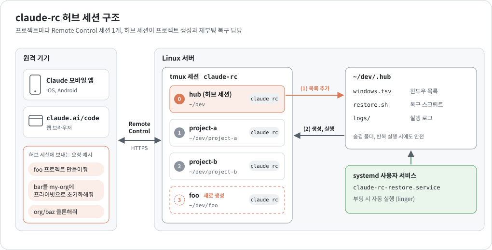
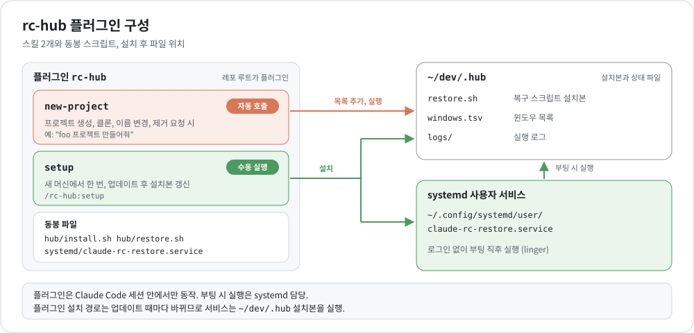
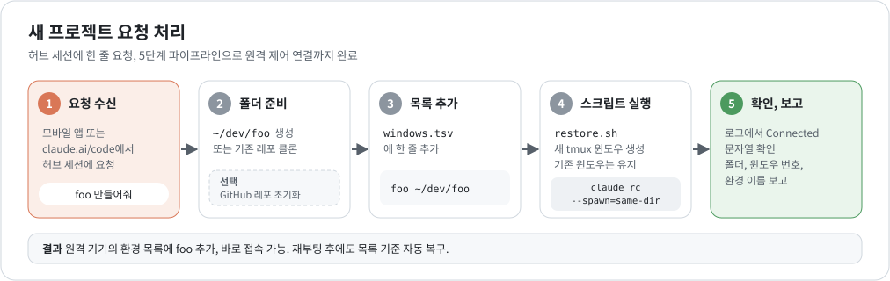
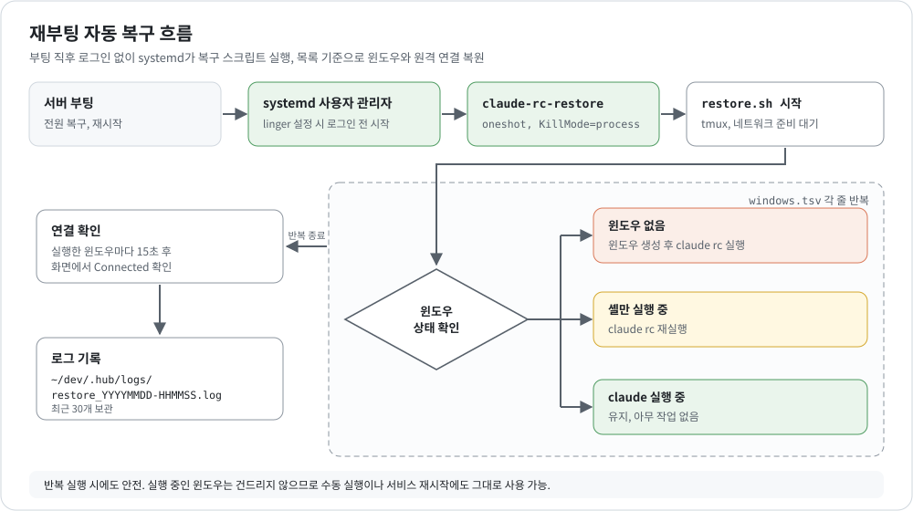

# claude-rc-hub-session

서버 한 대의 `~/dev` 아래 프로젝트마다 Claude Code Remote Control 세션을 하나씩 띄우고, 이 세션들을 **허브 세션** 하나가 생성하고 관리하는 구성입니다. 휴대폰이나 `claude.ai/code`에서 "foo 프로젝트 만들어줘" 한 줄을 보내면 폴더 준비, GitHub 레포 초기화, tmux 윈도우 생성, 원격 연결까지 끝납니다. 서버가 재부팅되면 systemd 사용자 서비스가 같은 구성을 자동으로 복구합니다.

Claude Code 플러그인 `rc-hub`로 설치합니다.

```bash
claude plugin install rc-hub --marketplace hungryZoo/claude-rc-hub-session
```



## 목차

1. [개요](#1-개요)
2. [구성 요소](#2-구성-요소)
3. [사전 준비](#3-사전-준비)
4. [설치 절차](#4-설치-절차)
5. [사용 방법](#5-사용-방법)
6. [재부팅 자동 복구](#6-재부팅-자동-복구)
7. [스킬과 프롬프트 원문](#7-스킬과-프롬프트-원문)
8. [문제 해결](#8-문제-해결)
9. [파일 구조](#9-파일-구조)

## 1. 개요

| 용어 | 설명 |
|---|---|
| Remote Control | 로컬 머신의 Claude Code 세션을 Claude 모바일 앱이나 `claude.ai/code`에서 조작하는 기능. `claude remote-control`, 줄여서 `claude rc`로 실행. |
| 프로젝트 세션 | 프로젝트 폴더마다 tmux 윈도우 1개, 그 안에서 실행 중인 `claude rc` 1개. 원격 기기에서는 프로젝트별 환경으로 표시. |
| 허브 세션 | `~/dev`에서 실행되는 프로젝트 세션. 새 프로젝트 요청을 받아 처리. |
| 스킬 | 요청 내용이 설명문과 맞으면 Claude Code가 자동으로 불러오는 절차 문서. 명령어 입력 없이 자연어 요청으로 동작. |
| 복구 체계 | 윈도우 목록 파일, 복구 스크립트, systemd 사용자 서비스로 구성된 재부팅 자동 복구 장치. |

이 구성이 적합한 경우는 다음과 같습니다.

- 서버 한 대를 여러 프로젝트의 작업 공간으로 사용하는 경우
- 터미널 접속 없이 휴대폰에서 새 프로젝트를 시작하고 싶은 경우
- 서버 재부팅 후 프로젝트 세션을 하나씩 다시 띄우는 작업을 없애고 싶은 경우

별도 프로그램이나 명령어 대신 스킬로 만든 이유는 휴대폰 사용 때문입니다. 원격 세션에서는 자연어 요청만 보내면 되고, 허브 세션의 Claude가 스킬 절차대로 서버에서 작업합니다.

## 2. 구성 요소



| 구성 요소 | 위치 | 역할 |
|---|---|---|
| 스킬 `new-project` | 플러그인 `skills/new-project` | 프로젝트 생성, 레포 클론, 이름 변경, 제거 절차. 요청 내용에 따라 자동 호출. |
| 스킬 `setup` | 플러그인 `skills/setup` | 초기 설정. `/rc-hub:setup`으로 수동 실행. |
| tmux 세션 | `claude-rc` | 프로젝트별 윈도우 보관. 첫 윈도우가 허브 세션. |
| 윈도우 목록 | `~/dev/.hub/windows.tsv` | `윈도우명<TAB>폴더 절대경로` 형식. 복구 순서 기준. |
| 복구 스크립트 | `~/dev/.hub/restore.sh` | 목록 기준 윈도우 생성과 `claude rc` 실행. 반복 실행 시에도 안전. |
| 실행 로그 | `~/dev/.hub/logs/` | 복구 스크립트 실행 기록. 최근 30개 보관. |
| systemd 서비스 | `~/.config/systemd/user/claude-rc-restore.service` | 부팅 시 복구 스크립트 실행. |

플러그인은 Claude Code 세션이 떠 있을 때만 동작합니다. 그래서 부팅 시 실행은 systemd 서비스가 맡고, 플러그인은 그 서비스를 설치하는 역할까지 합니다. 플러그인 설치 경로는 업데이트 때마다 바뀌므로 서비스는 `~/dev/.hub`에 복사한 설치본을 실행합니다.

## 3. 사전 준비

| 항목 | 확인 명령 |
|---|---|
| systemd 기반 Linux 서버 | `systemctl --user status` |
| tmux | `tmux -V` |
| Claude Code CLI와 구독 Claude 계정 로그인 | `claude --version`, `claude rc --help` |
| GitHub CLI 로그인 (레포 생성과 클론에 사용) | `gh auth status` |

Remote Control은 구독이 있는 Claude 계정으로 로그인한 상태에서만 동작합니다. `claude rc --help`의 요구 사항 항목에서 확인할 수 있습니다.

## 4. 설치 절차

### 4.1 플러그인 방식 (권장)

1. **플러그인 설치**
   ```bash
   claude plugin install rc-hub --marketplace hungryZoo/claude-rc-hub-session
   ```
   `--marketplace` 옵션이 없는 Claude Code 버전에서는 두 단계로 설치합니다.
   ```bash
   claude plugin marketplace add hungryZoo/claude-rc-hub-session
   claude plugin install rc-hub@hungryzoo
   ```
2. **초기 설정 실행**: 서버 터미널에서 Claude Code를 열고 설정 스킬을 실행합니다.
   ```bash
   mkdir -p ~/dev && cd ~/dev && claude
   ```
   ```
   /rc-hub:setup
   ```
   프로젝트 상위 폴더를 바꾸려면 `/rc-hub:setup ~/work`처럼 경로를 붙입니다.
3. **결과 확인**: Claude가 환경 확인, 파일 설치, 계획 확인, 세션 시작을 수행하고 결과를 보고합니다. 보고에 linger 안내가 있으면 직접 실행합니다.
   ```bash
   sudo loginctl enable-linger "$USER"
   ```
4. **설정용 세션 종료**: 이후에는 tmux `claude-rc` 세션의 hub 윈도우가 허브 세션 역할을 맡습니다.

### 4.2 프롬프트 방식

플러그인을 쓰지 않는 방법입니다. `~/dev`에서 Claude Code 세션을 열고 [`prompts/setup-prompt.md`](prompts/setup-prompt.md) 내용을 붙여넣습니다. 설정값의 `<GITHUB_ID>`, `<EMAIL>`, `<ORG>`는 미리 바꿔 둡니다. 이 방식에서는 스킬 대신 `~/dev/CLAUDE.md` 지침이 새 프로젝트 절차를 담당합니다.

### 4.3 수동 방식

```bash
git clone https://github.com/hungryZoo/claude-rc-hub-session.git /tmp/claude-rc-hub-session
/tmp/claude-rc-hub-session/hub/install.sh ~/dev       # 복구 스크립트, 목록, 서비스 설치
cp /tmp/claude-rc-hub-session/templates/CLAUDE.md ~/dev/CLAUDE.md   # 설정값 수정 필요
HUB_DRY_RUN=1 ~/dev/.hub/restore.sh                   # 실행 없이 계획만 출력
systemctl --user restart claude-rc-restore.service    # claude-rc 세션과 hub 윈도우 시작
```

처음 실행하는 폴더는 신뢰 확인 프롬프트가 뜹니다. 로그에 "대기"가 보이면 `tmux attach -t claude-rc`로 들어가 `y`를 입력하고 `Ctrl-b d`로 빠져나옵니다.

### 4.4 업데이트

```bash
claude plugin marketplace update hungryzoo
claude plugin update rc-hub@hungryzoo
```

플러그인에 `version`을 고정하지 않았으므로 레포의 새 커밋이 그대로 업데이트로 전달됩니다. 업데이트 후 `/rc-hub:setup`을 다시 실행하면 `~/dev/.hub`의 설치본이 갱신됩니다. 기존 파일은 백업하고, 실행 중인 윈도우는 건드리지 않습니다. 이미 실행 중인 세션에는 `/reload-plugins`를 입력하거나 세션을 새로 시작해야 반영됩니다.

## 5. 사용 방법

Claude 모바일 앱이나 `claude.ai/code`의 환경 목록에서 hub 환경(`~/dev`)을 선택하고 요청을 보냅니다.



| 요청 예시 | 허브 세션 동작 |
|---|---|
| foo 프로젝트 만들어줘 | `~/dev/foo` 생성, 목록 추가, 윈도우 생성과 `claude rc` 실행 |
| bar 프로젝트를 my-org에 프라이빗으로 초기화해줘 | 위 동작과 함께 `git init`, 초기 커밋, `gh repo create my-org/bar --private` |
| 내 깃허브에서 baz 클론해서 리모트 세션 열어줘 | `gh repo clone`, 목록 추가, 윈도우 생성과 `claude rc` 실행 |
| foo를 fooBar로 바꿔줘 | 세션 종료, 폴더 이름 변경, 목록 수정, 대화 기록 복사, 새 경로에서 세션 시작 |
| foo 세션 내려줘 | 목록에서 줄 삭제, 윈도우 종료. 폴더 삭제는 확인 후에만 수행. |

허브 세션이 연결 확인을 마치면 원격 기기의 환경 목록에 새 프로젝트가 나타납니다. 그 환경을 선택하면 해당 프로젝트 폴더에서 바로 작업할 수 있습니다. 스킬은 그 머신의 모든 세션에서 쓸 수 있으므로, 허브가 아닌 프로젝트 세션에서 요청해도 같은 절차가 실행됩니다.

서버에서 직접 확인할 때는 다음 명령을 씁니다.

```bash
tmux list-windows -t claude-rc -F '#{window_index}: #{window_name} [#{pane_current_path}]'
tmux attach -t claude-rc                       # 윈도우 화면 확인, Ctrl-b d로 빠져나오기
tail -n 30 "$(ls -1t ~/dev/.hub/logs/restore_*.log | head -1)"
```

## 6. 재부팅 자동 복구



부팅 직후 systemd 사용자 관리자가 `claude-rc-restore.service`를 실행하고, 서비스는 `restore.sh`를 호출합니다. linger가 켜져 있으면 로그인하지 않아도 이 과정이 진행됩니다. 스크립트는 tmux와 네트워크가 준비될 때까지 기다린 뒤 `windows.tsv`를 위에서부터 한 줄씩 처리합니다.

| 윈도우 상태 | 동작 |
|---|---|
| 윈도우 없음 | 윈도우 생성 후 `claude rc --spawn=same-dir` 실행 |
| 셸만 실행 중 | `claude rc --spawn=same-dir` 재실행 |
| claude 실행 중 | 유지 |
| 다른 프로그램 실행 중 | 건너뜀 |
| 목록의 폴더 없음 | 건너뜀 |

실행한 윈도우는 3초 간격으로 화면을 확인해 결과를 로그에 남깁니다. 기본 대기 시간은 60초입니다.

| 로그 표시 | 의미 |
|---|---|
| 연결 확인 | 화면에 `Connected` 표시. 원격 연결 완료. |
| 대기 | 폴더 신뢰 확인 프롬프트가 떠 있음. 해당 윈도우에 `y` 입력 필요. |
| 경고 | 대기 시간 안에 연결 미확인. 화면의 마지막 줄을 함께 기록. |

재부팅 후에는 원격 연결이 새로 만들어지므로 환경 이름이 바뀔 수 있습니다. 이전 대화 기록 파일은 `~/.claude` 아래에 그대로 남아 있습니다.

**수동 실행과 상태 확인**

```bash
~/dev/.hub/restore.sh                                  # 수동 복구
HUB_DRY_RUN=1 ~/dev/.hub/restore.sh                    # 계획만 출력
systemctl --user status claude-rc-restore.service      # 서비스 상태
journalctl --user -u claude-rc-restore.service -b      # 이번 부팅의 서비스 출력
```

**복구 스크립트 환경변수**

| 변수 | 기본값 | 용도 |
|---|---|---|
| `HUB_DRY_RUN` | `0` | `1`이면 실행 없이 계획만 출력 |
| `HUB_SESSION` | `claude-rc` | tmux 세션 이름 |
| `HUB_MANIFEST` | 스크립트 옆 `windows.tsv` | 목록 파일 경로 |
| `HUB_TMUX_BIN` | 자동 감지 | tmux 실행 파일 경로 |
| `HUB_TMUX_SOCKET` | 기본 소켓 | `tmux -L` 소켓 이름. 실제 세션과 분리된 테스트에 사용. |
| `HUB_CMD` | `claude rc --spawn=same-dir` | 윈도우에서 실행할 명령 |
| `HUB_CHECK_TIMEOUT` | `60` | 연결 확인 대기 시간(초). `HUB_CMD`를 지정하면 기본 `0`으로 확인 생략. |

**재부팅 없이 복구 시험하기**

실제 원격 세션을 만들지 않도록 별도 tmux 소켓과 대체 명령을 사용합니다.

```bash
systemd-run --user --wait -p KillMode=process \
  -E HUB_TMUX_SOCKET=hubtest -E 'HUB_CMD=claude --version; sleep 300' \
  ~/dev/.hub/restore.sh
tmux -L hubtest list-windows -t claude-rc      # 목록대로 윈도우 생성 확인
tmux -L hubtest kill-server                    # 시험 종료
```

**`KillMode=process`가 필요한 이유**

systemd는 기본적으로 서비스의 메인 프로세스가 끝나면 같은 cgroup에 남은 프로세스를 모두 종료합니다. 부팅 시 tmux 서버는 복구 스크립트의 자식으로 시작되므로 이 설정이 없으면 스크립트 종료 직후 tmux 서버와 모든 `claude rc`가 함께 종료됩니다. `KillMode=process`를 넣으면 서비스를 중지하거나 재시작해도 tmux 서버가 유지됩니다.

## 7. 스킬과 프롬프트 원문

플러그인 방식에서 쓰는 스킬 원문은 다음 파일에 있습니다.

| 스킬 | 파일 | 호출 방식 |
|---|---|---|
| `rc-hub:new-project` | [`skills/new-project/SKILL.md`](skills/new-project/SKILL.md) | 자동. 프로젝트 생성, 클론, 이름 변경, 제거 요청 시 |
| `rc-hub:setup` | [`skills/setup/SKILL.md`](skills/setup/SKILL.md) | 수동. `/rc-hub:setup [상위 폴더]` |

플러그인 없이 쓰는 경우의 프롬프트와 지침 원문입니다.

<details>
<summary><b>초기 설정 프롬프트</b> (<code>prompts/setup-prompt.md</code>, 새 머신에서 한 번 사용)</summary>

```markdown
너는 이 머신에 "claude-rc 허브 세션" 환경을 플러그인 없이 구성한다.
참고 레포: https://github.com/hungryZoo/claude-rc-hub-session

## 설정값
- 프로젝트 상위 폴더: ~/dev
- GitHub 사용자: <GITHUB_ID>
- 커밋 이메일: <EMAIL>
- 기본 GitHub 조직: <ORG> (없으면 개인 계정)

## 1. 환경 확인
- tmux 실행 경로와 버전. snap 설치이고 `tmux -V`가 출력 없이 끝나면 /snap/tmux/current/usr/local/bin/tmux 직접 호출.
- `claude rc --help` 동작, gh 로그인 상태, git 버전과 전역 사용자 정보, `systemctl --user show-environment` 동작
- Bash 샌드박스가 tmux 소켓 접근을 막으면 tmux, systemctl, 설치 스크립트, 복구 스크립트 호출만 샌드박스 해제로 실행.

## 2. 설치
- 참고 레포를 임시 폴더에 클론하고 `hub/install.sh ~/dev` 실행. 복구 스크립트, 윈도우 목록, systemd 사용자 서비스가 배치됨.
- tmux `claude-rc` 세션이 이미 있으면 기존 윈도우 이름과 경로를 ~/dev/.hub/windows.tsv에 반영.
- templates/CLAUDE.md → ~/dev/CLAUDE.md, 설정값 채움. 기존 파일이 있으면 덮어쓰지 말고 병합안 제시.

## 3. 검증과 시작
(1) `HUB_DRY_RUN=1 ~/dev/.hub/restore.sh` 로 계획 확인
(2) 테스트 소켓으로 재부팅 상황 재현 후 정리:
    `systemd-run --user --wait -p KillMode=process -E HUB_TMUX_SOCKET=hubtest -E 'HUB_CMD=claude --version; sleep 300' ~/dev/.hub/restore.sh`
    `tmux -L hubtest list-windows -t claude-rc` 확인 후 `tmux -L hubtest kill-server`
(3) `systemctl --user restart claude-rc-restore.service` 로 실제 시작, 최신 로그 확인
(4) 로그에 "대기 [hub]"가 있으면 hub 윈도우에 y 전송 후 "Connected" 확인

## 4. 보고
- 배치한 파일 목록, 검증 결과, 허브 윈도우 연결 여부와 환경 이름
- Linger=no면 `sudo loginctl enable-linger $USER` 실행 필요 사실을 나에게 알림
- 이 머신의 특이사항은 메모리에 기록
```

</details>

<details>
<summary><b>허브 지침</b> (<code>templates/CLAUDE.md</code>, <code>~/dev/CLAUDE.md</code>로 배치)</summary>

```markdown
# 허브 세션 지침

플러그인 없이 쓰는 경우의 지침이다. `rc-hub` 플러그인을 설치했다면 이 파일은 필요 없다.

이 폴더(`~/dev`)에서 실행되는 Claude Code 세션은 "허브 세션"이다. `~/dev`는 프로젝트 폴더만 모아두는 상위 폴더이고, 새 프로젝트 요청은 허브 세션이 처리한다. 프로젝트마다 tmux `claude-rc` 세션의 윈도우 1개와 그 안의 `claude rc` 프로세스 1개를 둔다.

## 설정값

- GitHub 사용자: `<GITHUB_ID>`
- 커밋 이메일: `<EMAIL>` (공개 레포는 `<ID>+<GITHUB_ID>@users.noreply.github.com` 권장)
- 기본 GitHub 조직: `<ORG>` (없으면 개인 계정)

## 새 프로젝트 요청 처리 (5단계 파이프라인)

1. **폴더 준비**
   - 새 프로젝트: `~/dev/<이름>/` 생성
   - 기존 레포: `gh repo clone <owner>/<repo>` 로 `~/dev/<repo>/` 클론
2. **GitHub 초기화** (요청한 경우만)
   - `git init` 후 `git checkout -b main` (git 2.28 미만은 `git init -b` 미지원)
   - 전역 git 사용자 정보가 없으면 레포 로컬로만 `git config user.name`, `git config user.email` 설정
   - `.gitignore`(`logs/`, `.venv/`, `__pycache__/`, `.env`)와 `README.md` 초기 커밋
   - `gh repo create <owner>/<이름> --private --source=. --remote=origin --push` (공개 요청 시 `--public`)
3. **목록 추가**: `~/dev/.hub/windows.tsv`에 `윈도우명<TAB>절대경로` 한 줄 추가. 구분자는 탭 문자.
4. **복구 스크립트 실행**: `~/dev/.hub/restore.sh`
   - 목록에 있고 tmux에 없는 윈도우만 생성 후 `claude rc --spawn=same-dir` 실행
   - 이미 실행 중인 윈도우는 유지
5. **확인과 보고**
   - 최신 로그 `~/dev/.hub/logs/restore_*.log`에서 "연결 확인" 확인
   - "대기" 표시(폴더 신뢰 프롬프트)면 레포의 `.claude/`, `.mcp.json` 존재 여부 확인 후 `tmux send-keys -t 'claude-rc:=<윈도우명>' y Enter`
   - 보고 항목: 폴더 경로, 윈도우 번호와 이름, 연결 여부, 환경 이름

## 운영 규칙

- 윈도우 실행 명령은 항상 `claude rc --spawn=same-dir`로 통일.
- 실행 중인 윈도우는 재시작 금지. 이름 변경 같은 비파괴 작업만 허용.
- 프로젝트 제거 요청: `windows.tsv`에서 해당 줄 삭제, `tmux kill-window -t 'claude-rc:=<윈도우명>'`. 폴더 삭제는 사용자 확인 후에만 수행.
- tmux가 snap 설치이고 `tmux -V`가 출력 없이 끝나면 `/snap/tmux/current/usr/local/bin/tmux`를 직접 호출.
- Bash 샌드박스가 tmux 소켓(`/tmp/tmux-<UID>/`) 접근을 막으면 tmux 명령만 샌드박스 해제로 실행.
- 이 머신에서 발견한 특이사항(tmux 경로, git 버전 등)은 메모리에 기록.
```

</details>

## 8. 문제 해결

| 증상 | 원인과 조치 |
|---|---|
| "프로젝트 만들어줘"에 스킬이 호출되지 않음 | 플러그인 설치 전에 시작한 세션. 세션에서 `/reload-plugins`를 입력하거나 hub 윈도우의 `claude rc`를 다시 시작. `claude plugin list`로 `rc-hub@hungryzoo`가 enabled인지 확인. |
| 플러그인을 업데이트했는데 복구 스크립트가 그대로임 | 서비스는 `~/dev/.hub` 설치본을 실행. `/rc-hub:setup` 재실행으로 설치본 갱신. |
| `tmux` 명령이 출력 없이 종료 | snap 설치 tmux의 `/snap/bin/tmux` 래퍼가 일부 환경에서 동작하지 않음. `/snap/tmux/current/usr/local/bin/tmux`를 직접 호출. 복구 스크립트는 자동 감지. |
| 스크립트 종료 직후 tmux 세션이 사라짐 | 서비스 파일에 `KillMode=process` 누락. `systemd-run`으로 시험할 때도 `-p KillMode=process` 필요. |
| 로그인하기 전까지 복구되지 않음 | linger 꺼짐. `sudo loginctl enable-linger "$USER"`. |
| 로그에 "대기" 표시 | 처음 실행하는 폴더의 신뢰 확인 프롬프트. 해당 윈도우에서 `y` 입력. |
| 스폰 모드 선택 질문이 뜸 | `--spawn=same-dir` 누락. 실행 명령 확인. |
| 허브 세션의 tmux 명령이 소켓 오류로 실패 | Claude Code Bash 샌드박스가 `/tmp/tmux-<UID>/` 접근을 막음. tmux 명령만 샌드박스 해제로 실행하도록 허용. |
| `git init -b main` 실패 | git 2.28 미만. `git init` 후 `git checkout -b main`. |
| 커밋 시 사용자 정보 오류 | 전역 git 설정 없음. 레포 안에서 `git config user.name`, `git config user.email` 설정. |
| 로그에 "경고", Connected 미확인 | 네트워크 지연이나 로그인 만료. `tmux attach -t claude-rc`로 화면 확인 후 필요하면 `claude auth login`. |

## 9. 파일 구조

```
claude-rc-hub-session/
├── .claude-plugin/
│   ├── plugin.json              # 플러그인 rc-hub 매니페스트
│   └── marketplace.json         # 마켓플레이스 hungryzoo
├── skills/
│   ├── new-project/SKILL.md     # 프로젝트 세션 생성, 이름 변경, 제거
│   └── setup/SKILL.md           # 초기 설정
├── hub/
│   ├── install.sh               # 설치 스크립트
│   ├── restore.sh               # 복구 스크립트 → ~/dev/.hub/restore.sh
│   └── windows.tsv.example      # 윈도우 목록 예시
├── systemd/
│   └── claude-rc-restore.service  # → ~/.config/systemd/user/
├── templates/
│   └── CLAUDE.md                # 플러그인 없이 쓸 때의 허브 지침
├── prompts/
│   └── setup-prompt.md          # 플러그인 없이 쓸 때의 초기 설정 프롬프트
└── docs/images/                 # README 그림
```

## 라이선스

[MIT](LICENSE)
